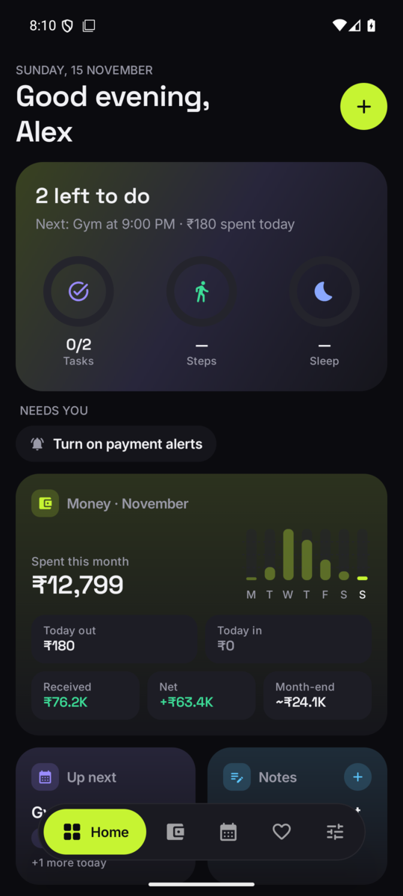
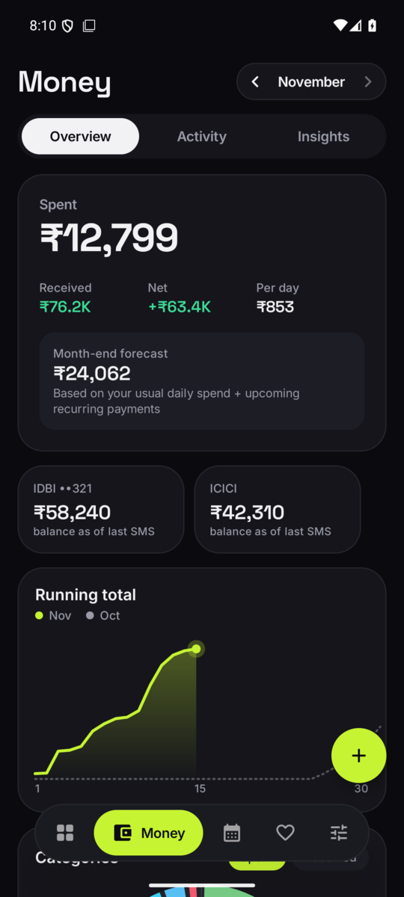
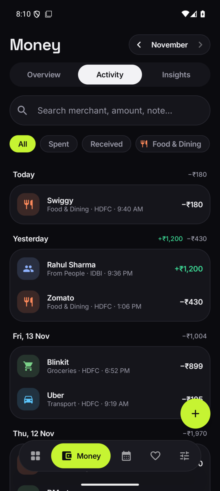
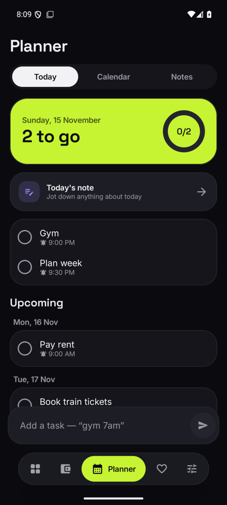

# Orbit

An offline personal tracking app for Android. It builds a picture of your money from bank SMS, and keeps your planner and health data beside it. The app has no internet permission, so nothing leaves the phone.

> This is a showcase repository. The source code is private; a walkthrough is available on request.

## Screenshots

<p>    </p>

All screens show sample data.

## What it does

| Area | Features |
|---|---|
| Money | Reads bank SMS, extracts each transaction, and assigns a merchant and category |
| Review | Flags unknown senders and unparsed formats for review, with masked samples for sharing |
| Analytics | Spending by category, weekly comparison, money sent to and received from people |
| Planner | Tasks, calendar, notes and reminders, with quick-add text parsing |
| Health | Steps, sleep estimated from phone use, screen time, weight and mood |
| Home | A daily brief and a week view across money, planner and health |
| Safety | Biometric lock, encrypted database, backup and restore, exports |

## How it is built

- **Language and UI:** Kotlin with Jetpack Compose
- **Storage:** Room on an SQLCipher-encrypted database, with the key held in the Android Keystore
- **SMS pipeline:** a bank sender registry, a rule-based parser, a merchant catalogue and a masker for sensitive values
- **Background work:** WorkManager sync and an SMS receiver for new messages
- **Health data:** Health Connect for steps, distance and calories
- **Tests:** unit tests for the parser, analytics, backup, exports and health insights

```
core/      database, security, preferences, backup
money/     SMS parsing, transaction data, analytics
planner/   tasks, calendar, reminders
health/    Health Connect and phone-usage data
ui/        Compose screens for each area
```

## Size

About 12,200 lines of Kotlin across 76 files, with 13 test files.

## How it was made

I designed the product and directed the build with AI coding agents, reviewing each release against my own data.
